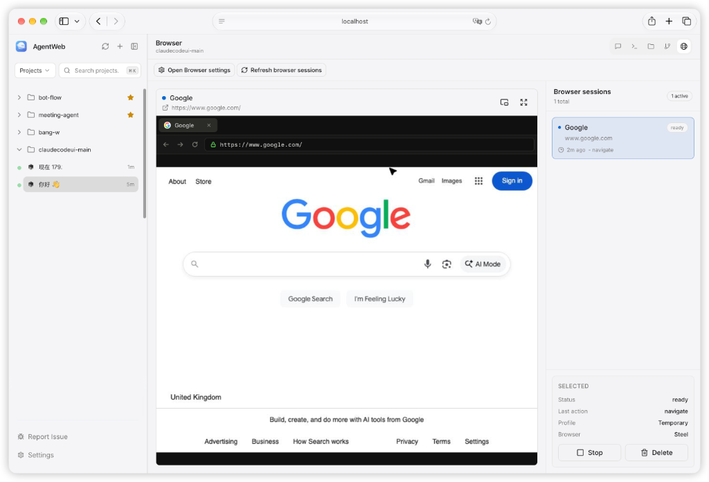
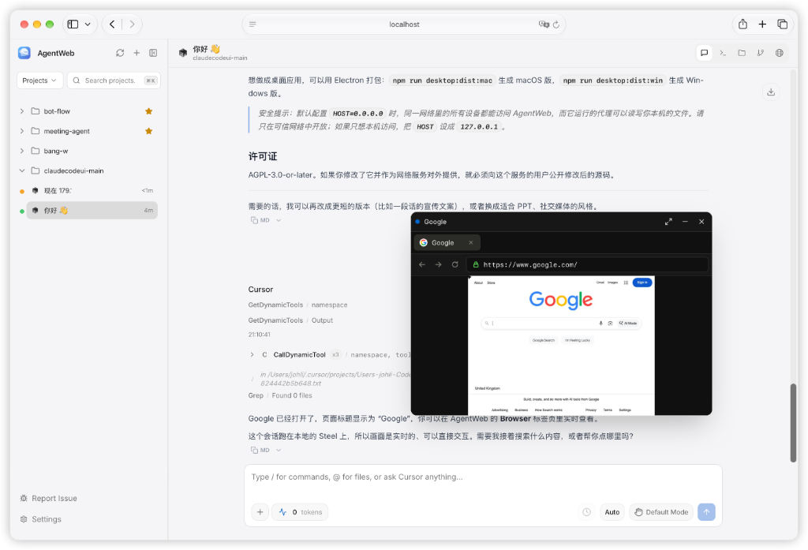

<div align="center">
 
 <h1>AgentWeb</h1>
 <p>A web, desktop, and mobile UI for <a href="https://docs.anthropic.com/en/docs/claude-code">Claude Code</a>, <a href="https://docs.cursor.com/en/cli/overview">Cursor CLI</a>, and <a href="https://developers.openai.com/codex">Codex</a>.</p>
</div>

<div align="right"><i><b>English</b> · <a href="./docs/README.zh-CN.md">简体中文</a></i></div>

---

## About

AgentWeb is a fork of [CloudCLI UI](https://github.com/siteboon/claudecodeui) (also known as Claude Code UI). It keeps the upstream workspace for Claude Code, Cursor CLI, and Codex, and adds a browser the agents can drive while you watch.

Ask an agent to open a page, click through a flow, or check a UI. The session shows up in the **Browser** tab: the page itself, plus status, the last action, and buttons to stop or delete it. With [Steel](https://github.com/steel-dev/steel-browser) that view is live. Without it, the tab shows screenshots from local Playwright. A floating window keeps the same page on screen while you stay in the chat.

AgentWeb runs on your own machine and uses the CLIs and subscriptions you already have. It does not provide any AI model itself.

<div align="center">

<p><sub>The Browser tab. The agent opened the page; you see the live view, the session list, and controls to stop or delete it.</sub></p>
</div>

## Features

- **Browser** — Agents open a browser you can watch. The Browser tab shows the live page (Steel) or screenshots (local Playwright), lists every session, and lets you stop or delete one. Pop the same session into a floating window so it stays visible while you chat.
- **Multiple agents** — Claude Code, Cursor CLI, and Codex in one workspace. Existing sessions are discovered automatically.
- **Chat interface** — Conversations with the agents, including session resume, history, and multiple sessions per project.
- **Shell terminal** — Direct access to the agent CLIs from a built-in terminal.
- **File explorer** — File tree with syntax highlighting and in-place editing.
- **Git** — View diffs, stage and commit changes, and switch branches.
- **Responsive layout** — Works on desktop, tablet, and phone.
- **Plugins** — Add custom tabs with their own frontend and optional Node.js backend.
- **TaskMaster AI** *(optional)* — Task planning and PRD parsing via [TaskMaster](https://github.com/eyaltoledano/claude-task-master).

## Requirements

- Node.js 22 or later (see `.nvmrc`)
- At least one agent CLI installed and signed in: Claude Code, Cursor CLI, or Codex

## Getting Started

```bash
git clone https://github.com/Reagan1947/AgentWeb.git
cd AgentWeb
npm install
```

Copy the example environment file and adjust it if needed:

```bash
cp .env.example .env
```

### Development

```bash
npm run dev
```

This starts the backend on `http://localhost:3001` and the Vite dev server on `http://localhost:5173`. Open the Vite URL in your browser.

### Production

```bash
npm start
```

This builds the frontend and backend, then serves everything from `http://localhost:3001`. To reach it from your phone or another device on the same network, open `http://<your-ip>:3001`.

### Desktop App

The Electron desktop app wraps the local server.

```bash
npm run desktop:dev        # run against the dev server (start `npm run dev` first)
npm run desktop:dist:mac   # build a macOS .dmg
npm run desktop:dist:win   # build a Windows installer
```

## Configuration

Common settings in `.env`:

| Variable | Default | Description |
|---|---|---|
| `SERVER_PORT` | `3001` | Backend API and WebSocket port |
| `VITE_PORT` | `5173` | Frontend dev server port |
| `HOST` | `0.0.0.0` | Bind address. Use `127.0.0.1` to allow local access only |
| `CLAUDE_CLI_PATH` | `claude` | Custom path to the Claude CLI |
| `DATABASE_PATH` | — | Custom location for the authentication database |

See [`.env.example`](.env.example) for the full list.

> **Security:** with the default `HOST=0.0.0.0`, AgentWeb is reachable from every device on your network, and the agents it runs can read and modify files on this machine. Only expose it on networks you trust.

### Browser

The Browser tab is where you follow the agent on the web. Each session shows its status, last action, and profile. From the tab you can open a floating window, go full screen, or stop and delete the session. The floating window stays over the chat, and you can send it back to the tab, minimize it, or hide it until the next session.

<div align="center">

<p><sub>The floating window stays over the conversation, so the page stays visible while you chat.</sub></p>
</div>

Enable the browser in **Settings > Browser**. Without further setup, sessions run on local Playwright and the Browser tab shows screenshots. If Chromium dependencies are missing, run:

```bash
npx playwright install-deps chromium
```

For a live, interactive view, install and run [Steel](https://github.com/steel-dev/steel-browser), then set its address in the same settings page (default `http://127.0.0.1:3000`). An API key is only needed for Steel Cloud.

## Plugins

Install plugins from a git repository in **Settings > Plugins**. To write your own, start from the [plugin starter template](https://github.com/cloudcli-ai/cloudcli-plugin-starter) or the local copy in [`plugins/starter`](plugins/starter).

Plugins are installed with `git clone` and updated with `git pull`, using the git credentials of the operating-system user running the server. The server cannot answer password or passphrase prompts, so for private repositories set up credentials for that user first:

- **`https://` URLs** — configure a credential helper, for example `gh auth login` followed by `gh auth setup-git`.
- **`git@` URLs** — use an SSH key that works without a prompt (no passphrase, or loaded into an `ssh-agent` the server inherits), and add the host to `~/.ssh/known_hosts`.

## Development Commands

| Command | Description |
|---|---|
| `npm run dev` | Start backend and frontend in development mode |
| `npm run build` | Build the frontend and backend |
| `npm run typecheck` | Type-check the frontend and backend |
| `npm run lint` | Lint `src/` and `server/` |
| `npm test` | Run backend tests |
| `npm run test:client` | Run frontend tests |

See [CONTRIBUTING.md](CONTRIBUTING.md) for contribution guidelines.

## License

GNU Affero General Public License v3.0 or later (AGPL-3.0-or-later). See [LICENSE](LICENSE) for the full text, including additional terms under Section 7, and [NOTICE](NOTICE).

If you modify this software and run it as a network service, you must make your modified source code available to the users of that service.

## Acknowledgments

- **[CloudCLI UI](https://github.com/siteboon/claudecodeui)** — the upstream project AgentWeb is based on.
- **[Claude Code](https://docs.anthropic.com/en/docs/claude-code)**, **[Cursor CLI](https://docs.cursor.com/en/cli/overview)**, and **[Codex](https://developers.openai.com/codex)** — the agent CLIs AgentWeb works with.
- **[React](https://react.dev/)**, **[Vite](https://vitejs.dev/)**, **[Tailwind CSS](https://tailwindcss.com/)**, and **[CodeMirror](https://codemirror.net/)**.
