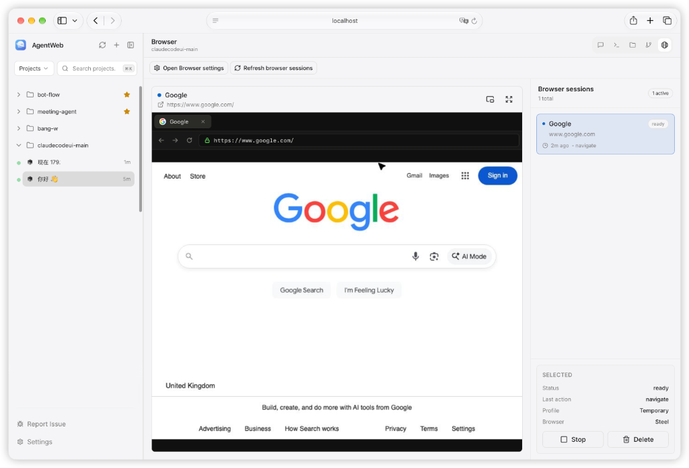
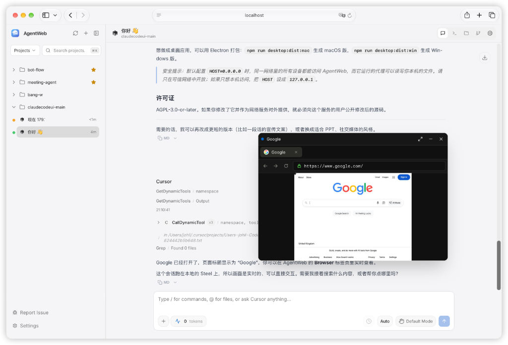

<div align="center">
 
 <h1>AgentWeb</h1>
 <p>面向 <a href="https://docs.anthropic.com/en/docs/claude-code">Claude Code</a>、<a href="https://docs.cursor.com/en/cli/overview">Cursor CLI</a> 和 <a href="https://developers.openai.com/codex">Codex</a> 的 Web、桌面与移动端界面。</p>
</div>

<div align="right"><i><a href="../README.md">English</a> · <b>简体中文</b></i></div>

---

## 关于本项目

AgentWeb 是 [CloudCLI UI](https://github.com/siteboon/claudecodeui)（也称 Claude Code UI）的 fork。它保留了上游面向 Claude Code、Cursor CLI 和 Codex 的工作区，并内置了一个浏览器：代理可以操作页面，你可以在界面里看着它做。

让代理打开网页、走一遍流程，或检查界面。会话会出现在 **Browser** 标签页里：页面本身，以及状态、最近一次操作，还有停止和删除按钮。接入 [Steel](https://github.com/steel-dev/steel-browser) 后，这个画面是实时的、可以直接看交互；不接的话，标签页显示本地 Playwright 的截图。悬浮窗会把同一个页面留在屏幕上，你继续留在对话里。

AgentWeb 运行在你自己的机器上，使用你已有的 CLI 和订阅，本身不提供任何 AI 模型。

<div align="center">

<p><sub>Browser 标签页。代理打开了页面；你能看到实时画面、会话列表，以及停止或删除会话的操作。</sub></p>
</div>

## 功能

- **浏览器** — 代理打开浏览器，你在旁边看。Browser 标签页显示实时页面（Steel）或截图（本地 Playwright），列出每个会话，并可以停止或删除。把同一个会话弹出成悬浮窗，聊天时画面也留在屏幕上。
- **多代理** — 在同一个工作区中使用 Claude Code、Cursor CLI 和 Codex，自动发现已有会话。
- **对话界面** — 与代理对话，支持恢复会话、查看历史，每个项目可以有多个会话。
- **Shell 终端** — 在内置终端中直接使用各代理的 CLI。
- **文件浏览器** — 文件树，支持语法高亮和直接编辑。
- **Git** — 查看 diff、暂存并提交更改、切换分支。
- **响应式布局** — 适配桌面、平板和手机。
- **插件** — 添加自定义标签页，可带独立前端和可选的 Node.js 后端。
- **TaskMaster AI**（可选）— 通过 [TaskMaster](https://github.com/eyaltoledano/claude-task-master) 进行任务规划和 PRD 解析。

## 环境要求

- Node.js 22 或更高版本（见 `.nvmrc`）
- 至少安装并登录一个代理 CLI：Claude Code、Cursor CLI 或 Codex

## 快速开始

```bash
git clone https://github.com/Reagan1947/AgentWeb.git
cd AgentWeb
npm install
```

复制示例环境变量文件，按需修改：

```bash
cp .env.example .env
```

### 开发模式

```bash
npm run dev
```

后端运行在 `http://localhost:3001`，Vite 开发服务器运行在 `http://localhost:5173`。在浏览器中打开 Vite 的地址。

### 生产模式

```bash
npm start
```

先构建前端和后端，然后统一由 `http://localhost:3001` 提供服务。要从手机或同一网络中的其他设备访问，打开 `http://<你的 IP>:3001`。

### 桌面应用

Electron 桌面应用封装了本地服务器。

```bash
npm run desktop:dev        # 连接开发服务器运行（需先执行 npm run dev）
npm run desktop:dist:mac   # 构建 macOS .dmg
npm run desktop:dist:win   # 构建 Windows 安装包
```

### Docker

在一台 Linux 机器上同时运行 AgentWeb、nono、各代理 CLI 和 Steel。需要 Docker 和 Compose 2.24 或更高版本，内核要启用 Landlock（nono 的网络规则需要 6.7 或更高）。

```bash
git clone https://github.com/Reagan1947/AgentWeb.git
cd AgentWeb
cp .env.docker.example .env
mkdir -p workspace
docker compose up -d --build
```

打开 `http://localhost:3001`，首次访问时设置密码。登录 Claude 有两种方式：在 `.env` 里设置 `ANTHROPIC_API_KEY`，或在 Shell 标签页运行 `claude login`。然后在 **设置 > nono** 中启用 nono，在 **设置 > Browser** 中启用浏览器。默认的 Steel 地址可以直接使用。

| `.env` 变量 | 默认值 | 用途 |
|---|---|---|
| `BIND_ADDRESS` | `127.0.0.1` | 直连端口 3001 和 3000 监听的网卡。除非明确需要，否则不要改。 |
| `STEEL_DOMAIN` | `localhost:3000` | 浏览器访问 Steel 用的地址。实时画面从这里加载。 |
| `STEEL_USE_SSL` | `false` | `STEEL_DOMAIN` 走 HTTPS 时设为 `true`。 |
| `PUBLIC_DOMAIN` | 空 | 你的域名，配合下面的 HTTPS 使用。 |
| `AGENTWEB_PORT` | `3001` | 网页界面在宿主机上的端口。 |
| `WORKSPACE_DIR` | `./workspace` | 挂载到 `/workspace` 的宿主机文件夹，项目放在这里。 |
| `AGENT_UID` | `1000` | 容器用户的 ID，需要对 `WORKSPACE_DIR` 有写权限。 |
| `OPTIONAL_TOOLS` | 空 | 构建进镜像的额外工具：`jdk8`、`jdk17`。 |

镜像预装了 AgentWeb 会启动的代理 CLI：Claude Code、Codex（`codex`）、Cursor（`cursor-agent`）和 OpenCode 1（`opencode`）。同时也预装了常用开发工具，因为代理自己无法安装系统软件：`gh`、`pnpm`、`bun`、`uv`、Python 的 `pip` 和 `venv`、Go、数据库客户端和 MEGAcmd。要加入 JDK 8 或 17（附带 Maven），在 `.env` 里设置 `OPTIONAL_TOOLS=jdk8,jdk17`。此时默认使用 JDK 17，把 `JAVA_HOME` 指向 `$JDK8_HOME` 即可切换。要加其他工具，修改 `docker/extra-tools.sh`。改完都需要重新构建。

Steel 和 AgentWeb 容器共用网络，所以它的 Chrome 能打开代理启动的开发服务。代理不能占用 3000 和 9223 端口。Steel 从固定的提交构建，因为它只发布 `latest` 镜像，而紧接着的下一个提交会破坏实时画面。要更换版本，修改 `STEEL_REF`。账号、Claude 登录状态和设置都保存在 `agent-home` 卷里。

Steel 本身没有登录校验，能访问到 3000 端口的人就能操作浏览器。在有公网地址的机器上不要设置 `BIND_ADDRESS=0.0.0.0`，请改用 HTTPS。

#### 使用域名和 HTTPS

1. 把你的域名和 `steel.<域名>` 指向这台机器，并在防火墙放行 80 和 443 端口。
2. 在 `.env` 里加上下面的配置，然后运行 `docker compose up -d`：

```bash
COMPOSE_PROFILES=https
PUBLIC_DOMAIN=example.com
STEEL_DOMAIN=steel.example.com
STEEL_USE_SSL=true
BIND_ADDRESS=127.0.0.1
```

Caddy 会自动申请和续期证书，并在提供 Steel 前通过域名 Cookie 校验你的 AgentWeb 登录状态。公网只开放 80 和 443。通过 SSH 隧道，AgentWeb 仍可在 `127.0.0.1:3001` 访问。

## 配置

`.env` 中的常用配置：

| 变量 | 默认值 | 说明 |
|---|---|---|
| `SERVER_PORT` | `3001` | 后端 API 与 WebSocket 端口 |
| `VITE_PORT` | `5173` | 前端开发服务器端口 |
| `HOST` | `0.0.0.0` | 监听地址。设为 `127.0.0.1` 则只允许本机访问 |
| `CLAUDE_CLI_PATH` | `claude` | 自定义 Claude CLI 路径 |
| `DATABASE_PATH` | — | 自定义认证数据库的位置 |

完整列表见 [`.env.example`](../.env.example)。

> **安全提示：** 默认 `HOST=0.0.0.0` 时，同一网络中的所有设备都能访问 AgentWeb，而它运行的代理可以读写本机文件。请只在可信网络中开放。

### 浏览器

Browser 标签页用来跟着代理看它在网页上做了什么。每个会话都会显示状态、最近一次操作和配置档。在这个标签页里可以打开悬浮窗、进入全屏，或停止并删除会话。悬浮窗盖在对话上面，也可以把它送回标签页、最小化，或先藏起来，直到下一个会话。

<div align="center">

<p><sub>悬浮窗留在对话上方，聊天的同时能看着页面。</sub></p>
</div>

在 **设置 > Browser** 中启用浏览器。会话有两种跑法。本地 Playwright 在 Browser 标签页里显示截图。[Steel](https://github.com/steel-dev/steel-browser) 则嵌入一个可以看着操作的实时页面。两种方式都要装好 Playwright：AgentWeb 通过它连上 Steel 会话。设置页提示缺少 Playwright 或 Chromium 时，点那里的 **安装运行时**。缺少 Chromium 的系统库时，运行：

```bash
npx playwright install-deps chromium
```

#### 连接 Steel

[Docker 部署](#docker)会自动启动 Steel。其他情况下 AgentWeb 不会自己启动 Steel：先在本机把 Steel 跑起来，再把它的地址保存到 AgentWeb。

**1. 启动 Steel**

Steel 文档里，本机进程用 Docker 启动：

```bash
docker run -p 3000:3000 -p 9223:9223 ghcr.io/steel-dev/steel-browser
```

让这个进程一直跑着。Steel 的 API 在 **3000** 端口。AgentWeb 生产模式用 **3001**，Vite 开发服务器用 **5173**，两边不抢同一个端口。打开 [http://127.0.0.1:3000/ui](http://127.0.0.1:3000/ui) 确认 Steel 已经起来。那个页面是 Steel 自己的界面。你要看的会话出现在 AgentWeb 的 Browser 标签页里。

**2. 在 AgentWeb 里保存地址**

打开 **设置 > Browser**，然后：

1. 打开 **启用浏览器**。
2. **Steel 地址**填 `http://127.0.0.1:3000`，对应上面的 Docker 命令。Steel 在别的机器上时，填那个 `http` 或 `https` 地址。密钥不要写进地址，也不要加上 `/v1` 路径。AgentWeb 会自己请求 `/v1/sessions`。
3. 本机这个进程的 **Steel API 密钥**留空。只有 Steel 服务要求密钥时才填写。
4. 点击 **保存 Steel 设置**。

状态行应变成 **Steel 地址：Steel 可连接**，浏览器状态为 **就绪**。AgentWeb 的服务器用这个地址创建会话，你打开 AgentWeb 的浏览器再去加载 Steel 返回的实时画面。同一台机器上，`http://127.0.0.1:3000` 两边都够用。要从另一台设备看画面，启动 Steel 前把它的 `DOMAIN` 设成那台设备能访问的主机。默认值是 `localhost:3000`。

**3. 打开页面**

让代理打开一个网址，或走一遍页面流程。Browser 标签页会列出这个会话，**浏览器**显示为 **Steel**，页面是实时画面。可以在这个画面里操作，把它弹出成悬浮窗，或在同一标签页里停止并删除会话。

自托管的 Steel 进程只跑一个 Chrome。新会话会接管实时画面。之前的会话还留在列表里，显示它最后打开的页面。

Steel 没在运行、本机又装了 Chromium 时，代理仍然能用浏览器，标签页显示的是 Playwright 截图。API 密钥被拒绝时会话会停下来：改密钥，或清空 **Steel 地址**再保存，就只使用本地 Playwright。命名的浏览器配置档也走本地 Playwright，因为配置档存在这台机器上。要看 Steel 实时画面时，不要指定配置档。

#### Steel Cloud

在 [app.steel.dev](https://app.steel.dev) 创建密钥。同一组设置里，**Steel 地址**填 `https://api.steel.dev`，把密钥贴进 **Steel API 密钥**，然后保存。AgentWeb 会用 `steel-api-key` 请求头带上这个密钥。

### nono

[nono](https://github.com/always-further/nono) 让 Claude 运行在内核强制的沙箱里，并把接口秘密留在服务器上。先在服务器上安装 nono（Docker 镜像已自带），再到 **设置 > nono** 中启用。

- **只作用于 Claude 会话。** Shell 标签页、文件树和其他代理不受限制。
- **Claude 能访问什么。** 当前项目、它自己的配置、`~/.npm` 和 `~/.m2` 等包管理器缓存，以及你添加的文件夹。Git worktree 还会自动获得共享的 `.git`。文件夹改动对新会话生效。
- **不能添加的文件夹。** 文件系统根目录、主目录和包含主目录的文件夹。在 Linux 上，nono 无法保护已授权目录下的 `~/.ssh` 等路径，所以会拒绝这样的策略。把主目录作为项目打开时也会因此被拒绝。
- **不会静默降级。** 启用 nono 后，如果 nono 缺失或拒绝策略，Claude 不会启动，对话里会显示原因。修复问题或关闭 nono 即可。

## 插件

在 **设置 > Plugins** 中从 git 仓库安装插件。要开发自己的插件，可以从[插件模板](https://github.com/cloudcli-ai/cloudcli-plugin-starter)或本地的 [`plugins/starter`](../plugins/starter) 开始。

插件通过 `git clone` 安装、`git pull` 更新，使用的是运行服务器的操作系统用户的 git 凭据。服务器无法响应密码或口令提示，因此安装私有仓库前，请先为该用户配置凭据：

- **`https://` 地址** — 配置凭据助手，例如先执行 `gh auth login`，再执行 `gh auth setup-git`。
- **`git@` 地址** — 使用无需交互的 SSH 密钥（没有口令，或已加载到服务器进程继承的 `ssh-agent` 中），并把主机加入 `~/.ssh/known_hosts`。

## 开发命令

| 命令 | 说明 |
|---|---|
| `npm run dev` | 以开发模式启动后端和前端 |
| `npm run build` | 构建前端和后端 |
| `npm run typecheck` | 对前端和后端做类型检查 |
| `npm run lint` | 对 `src/` 和 `server/` 运行 lint |
| `npm test` | 运行后端测试 |
| `npm run test:client` | 运行前端测试 |

贡献方式见 [CONTRIBUTING.md](../CONTRIBUTING.md)。

## 许可证

GNU Affero General Public License v3.0 或更高版本（AGPL-3.0-or-later）。完整条款（包括第 7 节的附加条款）见 [LICENSE](../LICENSE)，另见 [NOTICE](../NOTICE)。

如果你修改本软件并将其作为网络服务运行，必须向该服务的用户提供修改后的源代码。

## 致谢

- **[CloudCLI UI](https://github.com/siteboon/claudecodeui)** — AgentWeb 所基于的上游项目。
- **[Claude Code](https://docs.anthropic.com/en/docs/claude-code)**、**[Cursor CLI](https://docs.cursor.com/en/cli/overview)** 和 **[Codex](https://developers.openai.com/codex)** — AgentWeb 所支持的代理 CLI。
- **[React](https://react.dev/)**、**[Vite](https://vitejs.dev/)**、**[Tailwind CSS](https://tailwindcss.com/)** 和 **[CodeMirror](https://codemirror.net/)**。
